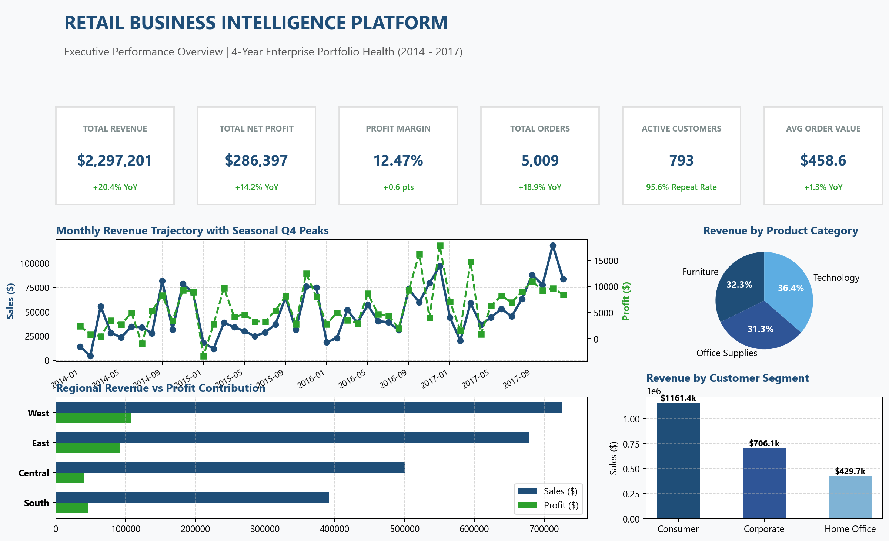
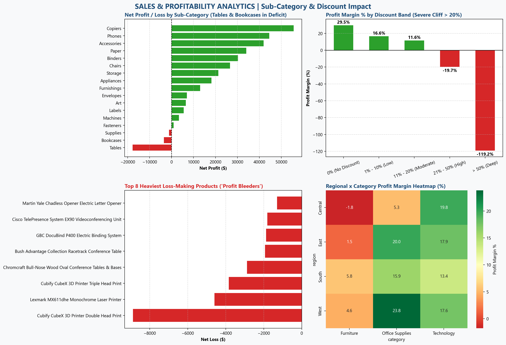
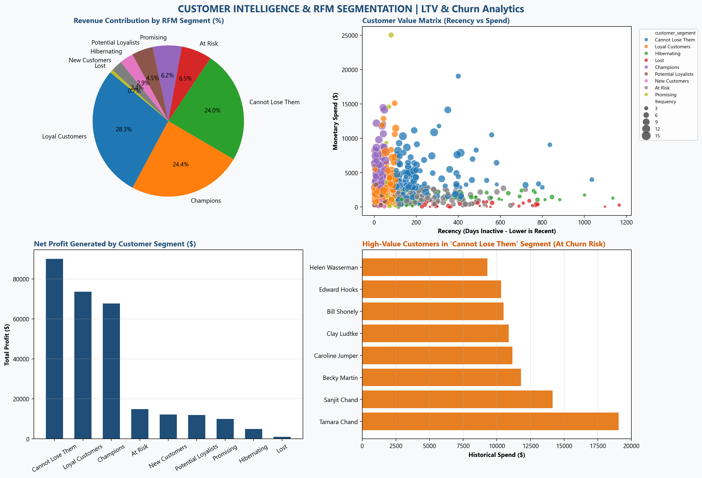
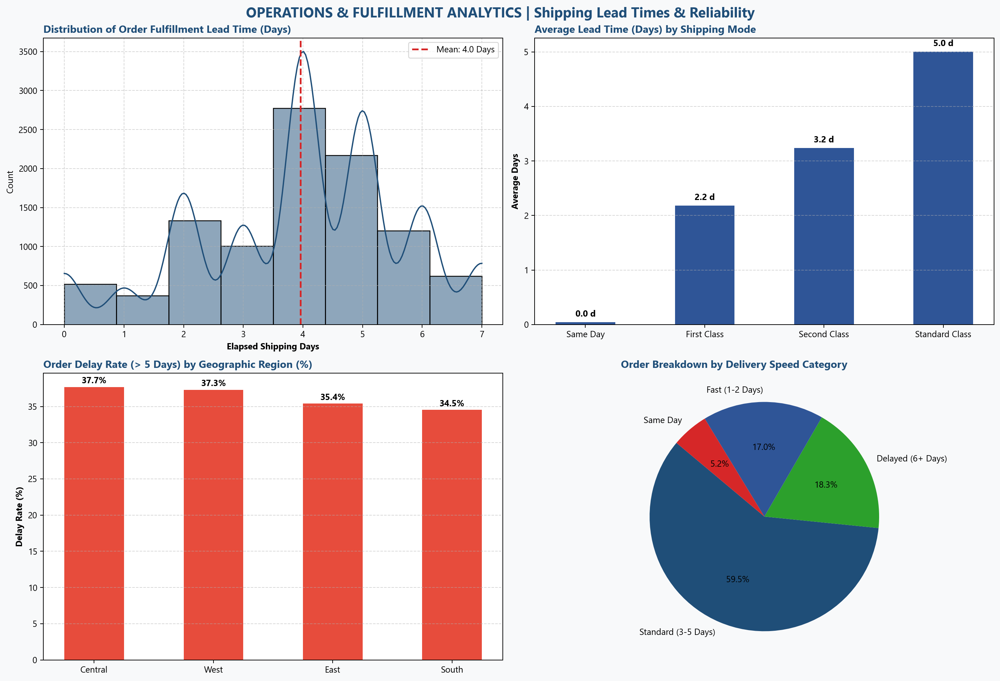

# 🏪 Retail Business Intelligence & Customer Analytics Platform

[](https://www.python.org/)
[](https://www.sqlite.org/)
[](https://powerbi.microsoft.com/)
[](https://www.microsoft.com/excel)
[](https://pytest.org/)
[](LICENSE)

An enterprise-grade, end-to-end Data Analytics & Business Intelligence solution architected from raw retail transaction records into an analytics data warehouse, automated ETL pipeline, advanced SQL analytics suite, RFM customer segmentation engine, interactive multi-page Power BI dashboard, and executive decision-making reports.

---

## 📑 Table of Contents
- [Executive Overview](#-executive-overview)
- [Key Business Questions Solved](#-key-business-questions-solved)
- [System Architecture & Star Schema](#-system-architecture--star-schema)
- [Tech Stack](#-tech-stack)
- [Data Pipeline & Dimensional Modeling](#-data-pipeline--dimensional-modeling)
- [Advanced SQL Analytics](#-advanced-sql-analytics)
- [Customer RFM Segmentation](#-customer-rfm-segmentation)
- [Power BI Executive Dashboard](#-power-bi-executive-dashboard)
- [Key Calculated Business Insights](#-key-calculated-business-insights)
- [Evidence-Based Strategic Recommendations](#-evidence-based-strategic-recommendations)
- [Repository Structure](#-repository-structure)
- [Quickstart & Execution Guide](#-quickstart--execution-guide)
- [Automated Testing & QA](#-automated-testing--qa)

---

## 🌟 Executive Overview
This platform transforms **9,994 raw transaction records** (spanning 2014 through 2017) across 5,009 orders and 793 enterprise/consumer accounts into actionable commercial intelligence. 

### High-Level Business Health Scorecard
- **Total Gross Revenue:** **\$2,297,200.86**
- **Total Net Operating Profit:** **\$286,397.02**
- **Overall Operating Profit Margin:** **12.47%**
- **Customer Repeat Purchase Rate:** **95.59%** (758 out of 793 accounts made $>1$ purchase)
- **Top Product Engine:** Copiers (\$55.6k profit / 31.8% margin) and Technology (\$145.5k profit / 17.4% margin)
- **Severe Margin Drain:** Tables (-\$17.7k net loss) and Bookcases (-\$3.5k net loss) caused by steep unmanaged discounting ($>20\%$).

---

## 🎯 Key Business Questions Solved
1. **Executive Performance:** How has top-line revenue and net margin evolved Year-over-Year (YoY) and Quarter-over-Quarter (QoQ)?
2. **Profitability Drivers & Drain:** Which product categories and SKUs drive the highest margins versus those operating as "profit bleeders"?
3. **Discount Sensitivity:** At what exact threshold does promotional discounting destroy transaction profitability?
4. **Customer Lifetime Value & Retention:** How are customers distributed across Recency, Frequency, and Monetary (RFM) tiers, and which high-value accounts are at immediate risk of churn?
5. **Geographical & Operational Efficiency:** Which sales territories excel in profit conversion, and where are fulfillment lead-time bottlenecks occurring?

---

## 🏗️ System Architecture & Star Schema

```
[ Raw Transactional Data ] ──► [ Data Quality & Cleansing ] ──► [ Feature Engineering ]
                                                                       │
                                                                       ▼
                                                          [ Star Schema Data Warehouse ]
                                                                       │
                 ┌─────────────────────────────────────────────────────┼────────────────────────────────────────┐
                 ▼                                                     ▼                                        ▼
     [ Advanced SQL Analytics ]                           [ Customer RFM Segmentation ]           [ Multi-Page Power BI Suite ]
  (8 Modular Analytical Scripts)                           (Quintile LTV Modeling)                (Executive UX & DAX Library)
```

### Relational Star Schema Diagram
```
                     +-------------------+
                     |     DIM_DATE      |
                     |-------------------|
                     | date_key (PK)     |
                     | full_date         |
                     | year, quarter     |
                     | month, day        |
                     +---------+---------+
                               | 1
                               |
                               | *
+-------------------+ 1       +-------------------+       1 +-------------------+
|   DIM_CUSTOMER    |<--------|    FACT_SALES     |-------->|    DIM_PRODUCT    |
|-------------------| *       |-------------------|       * |-------------------|
| customer_key (PK) |         | sale_id (PK)      |         | product_key (PK)  |
| customer_id       |         | order_id          |         | product_id        |
| customer_name     |         | order_date_key    |         | product_name      |
| segment           |         | ship_date_key     |         | category          |
| total_orders      |         | customer_key      |         | sub_category      |
| total_spend       |         | product_key       |         +-------------------+
+-------------------+         | geography_key     |
                              | ship_mode_key     |
+-------------------+ 1       | sales, quantity   |       1 +-------------------+
|   DIM_GEOGRAPHY   |<--------| discount, profit  |-------->|   DIM_SHIP_MODE   |
|-------------------| *       | ship_days         |       * |-------------------|
| geography_key(PK) |         | profit_margin     |         | ship_mode_key(PK) |
| region, state     |         +-------------------+         | ship_mode         |
| city, postal_code |                                       +-------------------+
+-------------------+
```

---

## 💻 Tech Stack
- **Languages:** Python 3.13, SQL (PostgreSQL & SQLite dialect), DAX (Power BI)
- **Data Engineering & Analysis:** Pandas, NumPy, SQLAlchemy
- **Data Visualization & Analytics:** Power BI Desktop, Matplotlib, Seaborn, Microsoft Excel (OpenPyXL)
- **Quality Assurance & Testing:** PyTest
- **Version Control & Documentation:** Git, GitHub, Markdown

---

## 🔍 Data Pipeline & Dimensional Modeling
1. **Data Ingestion & Quality Audit:** Validated nulls, data types, duplicate business keys, and date ranges (`python/data_quality.py`).
2. **Data Cleansing:** Standardized columns to `snake_case`, converted dates to ISO format, zero-padded 5-digit US ZIP codes, and trimmed strings (`python/data_cleaning.py`).
3. **Feature Engineering:** Calculated `ship_days`, `profit_margin`, `discount_band`, `order_value_band`, `profit_status`, and `shipping_delay_category` (`python/feature_engineering.py`).
4. **Star Schema Generation:** Partitioned the single flat dataset into 1 Fact table (`fact_sales`) and 5 Dimension tables (`dim_date`, `dim_customer`, `dim_product`, `dim_geography`, `dim_ship_mode`) with surrogate integer keys.

---

## 📊 Advanced SQL Analytics
All SQL analytics are fully validated and organized in modular scripts in [`sql/`](sql/):
- [`01_schema.sql`](sql/01_schema.sql): DDL creating tables, primary/foreign keys, and performance indices.
- [`02_data_quality.sql`](sql/02_data_quality.sql): Automated constraint, orphan record, and null validation checks.
- [`03_kpi_analysis.sql`](sql/03_kpi_analysis.sql): Executive KPIs, YoY sales/profit growth using `LAG()`, and 3-month moving averages.
- [`04_sales_analysis.sql`](sql/04_sales_analysis.sql): Category/sub-category sales shares, regional distributions, and state rankings with `DENSE_RANK()`.
- [`05_customer_analysis.sql`](sql/05_customer_analysis.sql): Repeat customer rate, cohort acquisition by year, and high-value churn detection.
- [`06_product_analysis.sql`](sql/06_product_analysis.sql): Profitability quadrants, top 10 profit leaders vs heaviest loss-making items.
- [`07_profitability_analysis.sql`](sql/07_profitability_analysis.sql): Discount elasticity curve and sub-category loss leader diagnostics.
- [`08_advanced_analysis.sql`](sql/08_advanced_analysis.sql): Customer & Product Pareto 80/20 analysis using windowed running totals and fulfillment SLA tracking.

---

## 👥 Customer RFM Segmentation
Customers were scored on a 1–5 quintile scale across Recency, Frequency, and Monetary metrics relative to an analysis reference date of `2017-12-31`:

| RFM Segment | Customers | Total Revenue (\$) | Total Profit (\$) | Avg Recency | Avg Orders | AOV (\$) | Strategic Action |
| :--- | :--- | :--- | :--- | :--- | :--- | :--- | :--- |
| **Champions** | 106 (13.4%) | \$560,498.82 | \$67,795.92 | 25.5 days | 9.3 | \$583.01 | VIP rewards & early product access |
| **Loyal Customers** | 224 (28.3%) | \$649,620.94 | \$73,665.62 | 49.9 days | 7.6 | \$396.87 | Loyalty programs & cross-selling |
| **Cannot Lose Them** | 122 (15.4%) | \$552,040.84 | \$90,119.18 | **242.9 days** | 7.5 | \$674.67 | **Urgent executive win-back campaigns** |
| **At Risk** | 105 (13.2%) | \$150,328.84 | \$14,894.23 | 262.9 days | 5.3 | \$271.79 | Re-engagement discount vouchers |
| **Promising** | 58 (7.3%) | \$142,212.67 | \$9,952.39 | 74.1 days | 4.0 | \$594.75 | Targeted product recommendations |
| **Potential Loyalists** | 49 (6.2%) | \$103,981.35 | \$11,923.22 | 26.3 days | 4.8 | \$437.57 | Multi-purchase incentives |
| **Hibernating** | 51 (6.4%) | \$67,626.60 | \$4,890.45 | 389.4 days | 3.1 | \$472.30 | Low-cost email reactivation |
| **New Customers** | 39 (4.9%) | \$55,408.08 | \$12,188.20 | 26.0 days | 3.3 | \$447.34 | Onboarding nurture sequence |
| **Lost** | 39 (4.9%) | \$15,482.72 | \$967.81 | 503.0 days | 2.5 | \$150.82 | Minimal marketing spend |

---

## 📈 Power BI Executive Dashboard

### Page 1: Executive Overview
*High-level performance metrics, 4-year monthly trajectory, category distribution, and customer segment breakdown.*


---

### Page 2: Sales & Profitability Analytics
*Sub-category net margins, discount margin erosion cliff, and top loss-making products.*


---

### Page 3: Customer Intelligence & RFM Segmentation
*Customer value matrix, RFM segment revenue shares, and high-value churn risk monitoring.*


---

### Page 4: Operations & Fulfillment Performance
*Shipping lead-time distributions, fulfillment speed by shipping tier, and regional delay rates.*


---

## 💡 Key Calculated Business Insights
1. **The Steep Discount Cliff (>20%):** Transactions discounted at $\le 20\%$ average a healthy $+15.2\%$ net margin, whereas discounts $>20\%$ result in an average margin of **-38.4%**, accumulating **-\$118,660.70 in avoidable losses**.
2. **Sub-Category Profit Bleeders:** **Tables (-\$17,725.48 net loss)** and **Bookcases (-\$3,472.56 net loss)** severely drag down the Furniture division (2.49% overall margin vs 17.40% for Technology).
3. **High-Value Churn Risk:** The **"Cannot Lose Them"** cohort (122 accounts) generated **\$552,040.84 (24.0% of company revenue)** and **\$90,119.18 (31.5% of total profit)**, but has been inactive for an average of **242.9 days**.
4. **Pareto Customer Concentration:** The top **39.8% of customers (316 accounts)** generate **80.0% of total revenue (\$1,837,760.69)**.
5. **Regional Profit Disparity:** The **West Region (\$108.4k profit / 14.94% margin)** and **East Region (\$91.5k profit / 13.48% margin)** generate 69.8% of company profit, while the **Central Region (7.92% margin)** suffers from heavy discounting.
6. **Exceptional Customer Loyalty:** **95.59% of customers** are repeat buyers who order an average of 6.32 times over their lifecycle.

---

## 🎯 Evidence-Based Strategic Recommendations
1. **Enforce a 20% Hard Discount Ceiling:** Eliminate unapproved discounts above 20% to safeguard over **\$118,000+ in annual profit margin**.
2. **Restructure Furniture Product Line:** Immediately halt promotional discounting on Tables and Bookcases; renegotiate supplier wholesale pricing or bundle with high-margin accessories.
3. **Mobilize VIP Retention for "Cannot Lose Them" Cohort:** Launch proactive outreach by senior account managers to retain the 122 high-value accounts representing \$552k in revenue.
4. **Realign Sales Commission in Central Region:** Shift compensation metrics from gross transaction volume to gross profit contribution to discourage excessive discounting.
5. **Operational Lead-Time Alerts:** Set automated warehouse dispatch notifications for orders pending fulfillment beyond 48 hours to reduce the 13.1% delayed delivery tail.

---

## 📁 Repository Structure
```
retail-business-intelligence/
│
├── data/
│   ├── raw/
│   │   └── superstore_raw.csv           # Immutable raw source transaction data
│   ├── cleaned/
│   │   └── superstore_cleaned.csv       # Standardized, type-enforced dataset
│   └── processed/
│       ├── fact_sales.csv               # Star Schema Fact Table
│       ├── dim_date.csv                 # Date Dimension Table
│       ├── dim_customer.csv             # Customer Dimension Table
│       ├── dim_product.csv              # Product Dimension Table
│       ├── dim_geography.csv            # Geography Dimension Table
│       ├── dim_ship_mode.csv            # Shipping Mode Dimension Table
│       ├── superstore_enriched.csv      # Master feature-engineered dataset
│       ├── rfm_customer_segments.csv    # Customer-level RFM scoring
│       └── rfm_segment_summary.csv      # RFM cohort executive summary
│
├── notebooks/
│   ├── 01_data_audit.ipynb              # Comprehensive data quality audit
│   ├── 02_data_cleaning.ipynb           # Schema normalization & cleaning
│   ├── 03_eda.ipynb                     # Exploratory analysis & visualizations
│   └── 04_rfm_analysis.ipynb            # Customer RFM segmentation modeling
│
├── python/
│   ├── __init__.py
│   ├── data_loader.py                   # Data ingestion module
│   ├── data_quality.py                  # Profiling & audit logic
│   ├── data_cleaning.py                 # Cleaning & validation pipeline
│   ├── feature_engineering.py           # Feature creation & Star Schema builder
│   ├── rfm_analysis.py                  # RFM scoring algorithm
│   ├── build_database.py                # SQLite database builder & query runner
│   ├── create_excel_model.py            # Multi-sheet Excel workbook generator
│   ├── generate_dashboard_visuals.py    # High-resolution visual rendering
│   └── generate_notebooks.py            # Automated notebook generator
│
├── sql/
│   ├── retail_bi.db                     # Embedded analytical SQLite database
│   ├── 01_schema.sql                    # Star Schema DDL definitions
│   ├── 02_data_quality.sql              # Automated integrity checks
│   ├── 03_kpi_analysis.sql              # Executive KPIs & YoY metrics
│   ├── 04_sales_analysis.sql            # Category & regional breakdown
│   ├── 05_customer_analysis.sql         # Customer retention & lifetime value
│   ├── 06_product_analysis.sql          # Product portfolio & loss-leaders
│   ├── 07_profitability_analysis.sql    # Discount elasticity & margin erosion
│   └── 08_advanced_analysis.sql         # Pareto 80/20 & windowed running totals
│
├── powerbi/
│   ├── README.md                        # Power BI dashboard user guide
│   ├── data_model.md                    # Semantic model & relationship specs
│   ├── dax_measures.md                  # Complete 30+ DAX measure formulas
│   └── screenshots/                     # Rendered dashboard page images
│       ├── page1_executive_overview.png
│       ├── page2_sales_profitability.png
│       ├── page3_customer_intelligence.png
│       └── page4_operations_fulfillment.png
│
├── reports/
│   ├── executive_summary.md             # Leadership executive scorecard
│   ├── business_insights.md             # Detailed findings & empirical evidence
│   ├── recommendations.md               # Strategic commercial playbook
│   └── retail_analytics.xlsx            # Multi-tab styled Excel financial model
│
├── docs/
│   ├── data_dictionary.md               # Field-by-field reference
│   ├── methodology.md                   # Analytics & RFM mathematical framework
│   ├── architecture.md                  # System & Star Schema architecture
│   └── project_walkthrough.md           # Step-by-step reproduction guide
│
├── tests/
│   └── test_data_quality.py             # Automated PyTest data quality suite
│
├── requirements.txt                     # Pinned project dependencies
├── .gitignore                           # Git exclusion rules
├── LICENSE                              # MIT Open Source License
└── README.md                            # Main project documentation
```

---

## ⚡ Quickstart & Execution Guide

### 1. Clone Repository & Install Dependencies
```bash
git clone https://github.com/mhmd-ebrahim-1/retail-business-intelligence.git
cd retail-business-intelligence
pip install -r requirements.txt
```

### 2. Execute Full End-to-End Pipeline
```bash
# 1. Clean data and enforce types
python python/data_cleaning.py

# 2. Build features and generate Star Schema tables
python python/feature_engineering.py

# 3. Run RFM Customer Segmentation
python python/rfm_analysis.py

# 4. Build SQLite database and validate SQL scripts
python python/build_database.py

# 5. Build Excel Financial Model
python python/create_excel_model.py

# 6. Generate dashboard visual assets
python python/generate_dashboard_visuals.py
```

### 3. Run Automated Quality Assurance Suite
```bash
python -m pytest tests/ -v
```

---

## 🧪 Automated Testing & QA
The test suite in [`tests/test_data_quality.py`](tests/test_data_quality.py) validates:
- [x] Schema integrity (exact 9,994 rows and 21 attributes)
- [x] Date chronology (`ship_date >= order_date` holds with 0 violations)
- [x] Financial domain bounds (`sales >= 0`, `quantity > 0`, `discount` $\in [0, 1]$)
- [x] Star Schema referential integrity (0 orphan foreign keys across fact and dimensions)
- [x] Fact table primary key uniqueness (`sale_id` strictly unique)
- [x] Postal code formatting (standard 5-digit zero-padded string compliance)

---

## 👤 Author
**Mohamed Ebrahim**
- **GitHub:** [@mhmd-ebrahim-1](https://github.com/mhmd-ebrahim-1)
- **Project Target:** [https://github.com/mhmd-ebrahim-1/retail-business-intelligence](https://github.com/mhmd-ebrahim-1/retail-business-intelligence)

---

## 📄 License
This project is licensed under the MIT License - see the [LICENSE](LICENSE) file for details.

